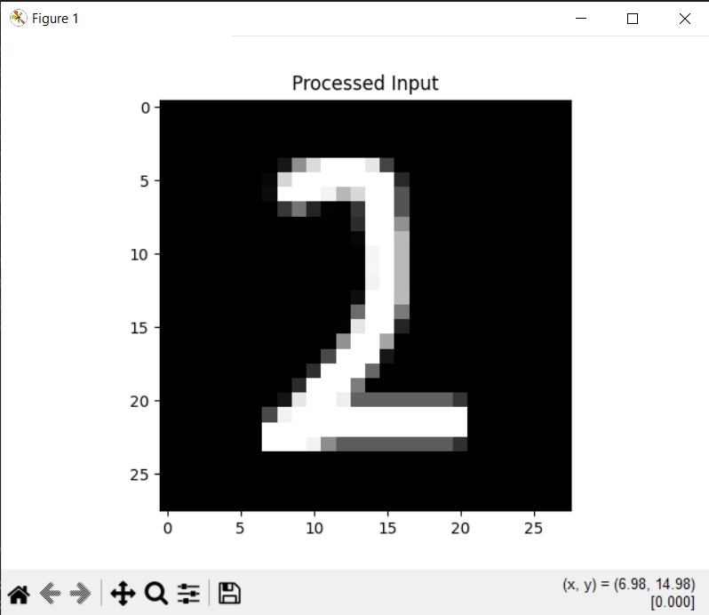

# Handwritten Digit Recognition System (CNN Hybrid)

A deep learning-based application that recognizes handwritten digits (0–9) using a Convolutional Neural Network (CNN).
The system supports real-time drawing input via a GUI as well as single image prediction.

---

## 🚀 Features

* ✍️ Draw digits on canvas and get instant predictions
* 🖼️ Upload image input for classification
* 🧠 Custom-built CNN (no heavy frameworks)
* ⚡ Fast and lightweight model (~1.3 MB)
* 🎯 High accuracy on MNIST dataset

---

## 🛠️ Tech Stack

* Python
* NumPy
* Tkinter (GUI)
* Custom CNN implementation

---

## 📂 Project Structure

```
CNN_HYBRID/
│
├── data/               # Dataset loading
├── models/             # CNN architecture & layers
├── training/           # Training logic
├── ui/                 # GUI (drawing canvas)
├── utils/              # Preprocessing & helpers
├── saved_models/       # Trained model (.pkl)
│
├── main.py             # Entry point
├── requirements.txt
└── README.md
```

---

## ⚙️ Installation

```bash
git clone <your-repo-url>
cd CNN_HYBRID

pip install -r requirements.txt
```

---

## ▶️ Run the App

```bash
python main.py
```

---

## 🧪 Model Details

* Dataset: MNIST
* Input: 28x28 grayscale images
* Architecture:

  * Convolution Layers
  * Activation Functions
  * Fully Connected Layers
* Output: Digit (0–9)

---

## 📸 Screenshots

### 🖌️ Drawing And Prediction


### 🔢 Processed Input



---

## 🎥 Demo Flow

1. Launch the application
2. Draw a digit on the canvas
3. Click **Predict**
4. Model processes input
5. Predicted digit is displayed

---

## 📈 Future Improvements

* Improve accuracy for confusing digits (e.g., 7 vs 1)
* Add real-time probability visualization
* Deploy as a web app
* Use advanced CNN (TensorFlow/PyTorch)

---

## 👨‍💻 Author

* Group members: Vaishnavi Bhagat, Shloka Bendke, Devyani Ayare, Manasi Auchatkar

---

## 📜 License

This project is for academic purposes.

